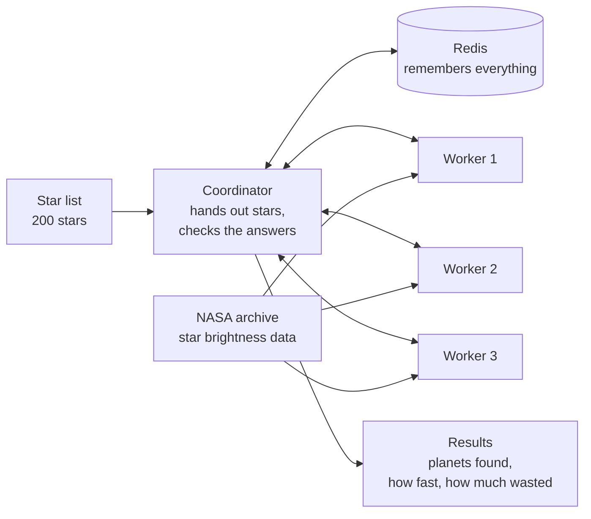
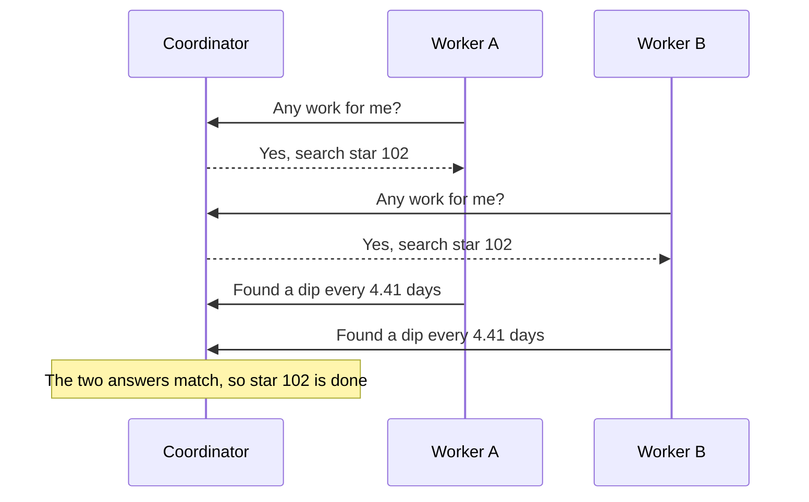

# Architecture

AntSearch looks for planets around 200 stars by sharing the work across many computers. One program, the coordinator, hands out stars. The other computers, the workers, each search one star at a time and send back what they found.

## The big picture

| Part | Its job |
|---|---|
| Coordinator | Keeps the queue of stars, decides which worker gets the next one, and checks the answers |
| Redis | A small database the coordinator saves everything in, so a restart loses nothing |
| Worker | Downloads one star's brightness data from NASA, searches it for a planet, and reports back |
| Scheduler | The part of the coordinator that picks the worker. Ours is the "ant" scheduler |

## What happens to one star

Every star is given to two different workers. The answer only counts if both agree.

1. We give the coordinator the list of stars.
2. A worker asks for work. The scheduler decides whether that worker gets the next star.
3. The worker downloads the star's data, runs the search, and sends back the result.
4. A second worker does the same star.
5. If the two answers match, the star is done. If they don't, a third worker breaks the tie.

## How the ant scheduler picks a worker

Real ants leave a scent trail on a good path, and other ants follow the strongest trail. We do the same with workers:

- A worker that answers quickly and correctly gets more scent, so it is picked more often.
- A worker that is slow, fails, or gives a wrong answer gets none.
- All scent fades a little after every task, so old behaviour is forgotten.
- No worker ever drops to zero, so a slow one still gets another chance.

## When something goes wrong

| Problem | What the system does |
|---|---|
| A worker crashes or loses its connection | Workers send "I'm alive" messages. When they stop, the coordinator gives that worker's star to someone else |
| A worker sends a wrong answer | The other workers outvote it, and it is flagged |
| The coordinator restarts | Everything is saved in Redis, so it carries on where it left off |

## Where it runs

Everything can run on one laptop for testing (`make up`), or across several computers on the same network: one runs the coordinator, and every other machine runs a worker that connects to it.

## Which file is which

| File | What it does |
|---|---|
| `coordinator.py` | The coordinator |
| `scheduler.py` | Picks which worker gets a star |
| `worker.py` | The worker |
| `pipeline.py` | The planet search itself |
| `validation.py` | Compares two workers' answers |
| `metrics.py` | Measures how a run went |
