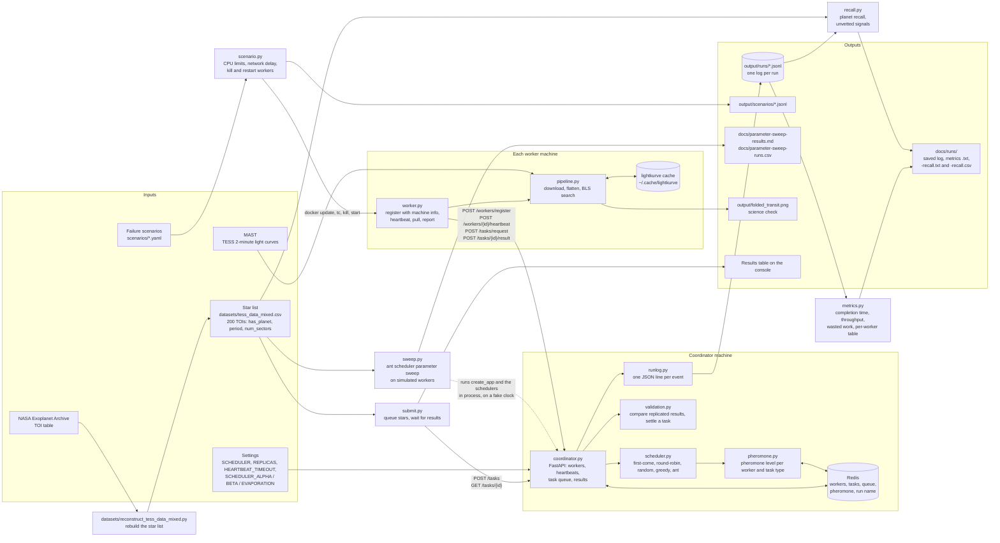
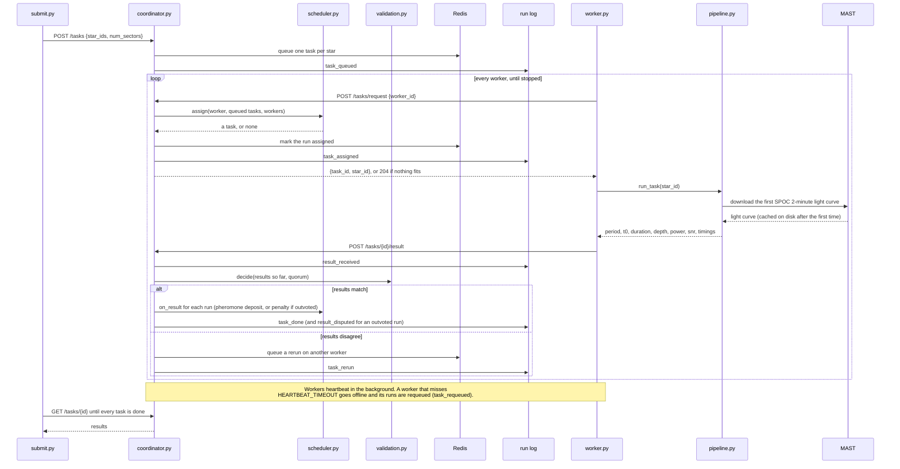
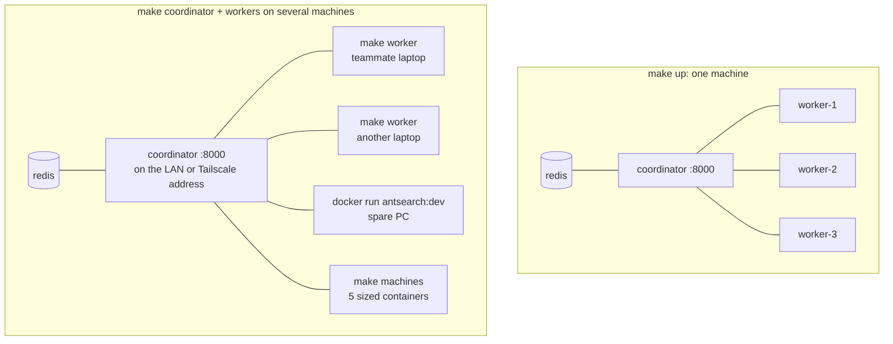

# Architecture

AntSearch searches TESS light curves for transiting planets across a cluster of volunteer machines. A coordinator holds the task queue and picks which worker gets each star; workers download a star's light curve, run the transit search and send back the result. Every run leaves a log that the metrics and recall scripts turn into results.

## Components, files, inputs and outputs

Solid arrows are data at run time. The dotted arrow is `sweep.py` reusing the coordinator's code in-process rather than talking to a running one.

## A task's life

Each star is one task. With `REPLICAS=2` (the default) it runs on two different workers, and the coordinator only accepts a result when both match.

## Deployment

The same Docker image runs the coordinator and the workers. The coordinator side always runs in Docker Compose; workers can be containers or plain Python processes on any machine that can reach the coordinator's port.

## Files

| File | What it does | Inputs | Outputs | Run with |
|---|---|---|---|---|
| `src/antsearch/coordinator.py` | HTTP API for workers and clients; keeps all state in Redis; assigns tasks through the scheduler; settles replicated results | HTTP requests, settings from the environment, Redis | HTTP responses, Redis state, run log events | `make up`, `make coordinator` |
| `src/antsearch/scheduler.py` | Picks a task for a worker that asks: first-come, round-robin, random, greedy or ant (pheromone and recent speed) | Queued tasks, workers, pheromone levels | The chosen task; pheromone updates on each result | via the coordinator |
| `src/antsearch/pheromone.py` | Pheromone level per worker and task type (short or multi-sector), with evaporation and bounds | Deposits and penalties from the scheduler | Levels stored in Redis | via the scheduler |
| `src/antsearch/validation.py` | Compares results from different workers (ignoring timings, allowing rounding) and decides accept, wait, rerun or unresolved | Results of a task's runs | A decision | via the coordinator |
| `src/antsearch/runlog.py` | Appends one JSON line per event; reads logs back | Events from the coordinator | `output/runs/<run>.jsonl` | via the coordinator |
| `src/antsearch/worker.py` | Registers with its machine details, sends heartbeats, pulls tasks, runs them, reports results with retries | `COORDINATOR_URL`, `WORKER_ID`, `WORKER_TASK` | Results sent to the coordinator | `make worker`, compose workers, `make machines` |
| `src/antsearch/pipeline.py` | Transit search: download a light curve, flatten it, run BLS twice, return the best signal and its SNR; also a single-star science check | Star name, MAST, the download cache | Result dict; `output/folded_transit.png` from the science check | via workers; `python -m antsearch.pipeline` |
| `src/antsearch/submit.py` | Queues stars from the star list and waits for them | Star list CSV, `--limit` | Tasks on the coordinator; results table on the console | `make submit` |
| `src/antsearch/metrics.py` | Completion time, turnaround, throughput, wasted work and a line per worker | A run log | Report on the console; with `--save`, the log and `<run>.txt` in `docs/runs/` | `make metrics`, `make save-run` |
| `src/antsearch/recall.py` | Share of known planets found again; strong signals on stars with no known planet | A run log, the star list | Report on the console; with `--save`, `<run>-recall.txt` and `.csv` | `make recall`, `make save-run` |
| `src/antsearch/scenario.py` | Applies failures to compose workers on a timeline | `scenarios/*.yaml`, the running stack | Docker changes; `output/scenarios/<name>.jsonl` | `make scenario` |
| `src/antsearch/sweep.py` | Runs the coordinator and ant scheduler in-process on simulated workers over a grid of alpha, beta and evaporation | The star list, parameter grid | `docs/parameter-sweep-results.md`, `docs/parameter-sweep-runs.csv` | `make sweep` |
| `src/antsearch/datasets/tess_data_mixed.csv` | The 200-star list: 100 confirmed planets, 100 false positives | | Read by submit, recall and sweep | |
| `src/antsearch/datasets/reconstruct_tess_data_mixed.py` | Rebuilds the star list | NASA Exoplanet Archive TOI table, MAST sector counts | The star list CSV | `python` by hand |
| `compose.yaml` | Redis, the coordinator and three workers on one machine | Settings from the environment | Containers on port 8000 | `make up` |
| `compose.machines.yaml` | Five worker containers with different CPU and memory limits | `COORDINATOR_URL` | Containers that join a coordinator | `make machines` |
| `Dockerfile` | One image for the coordinator and workers, with the science libraries and `tc` | | `antsearch:dev` | `make build` |
| `Makefile` | Shortcuts for everything above | | | `make help` |
